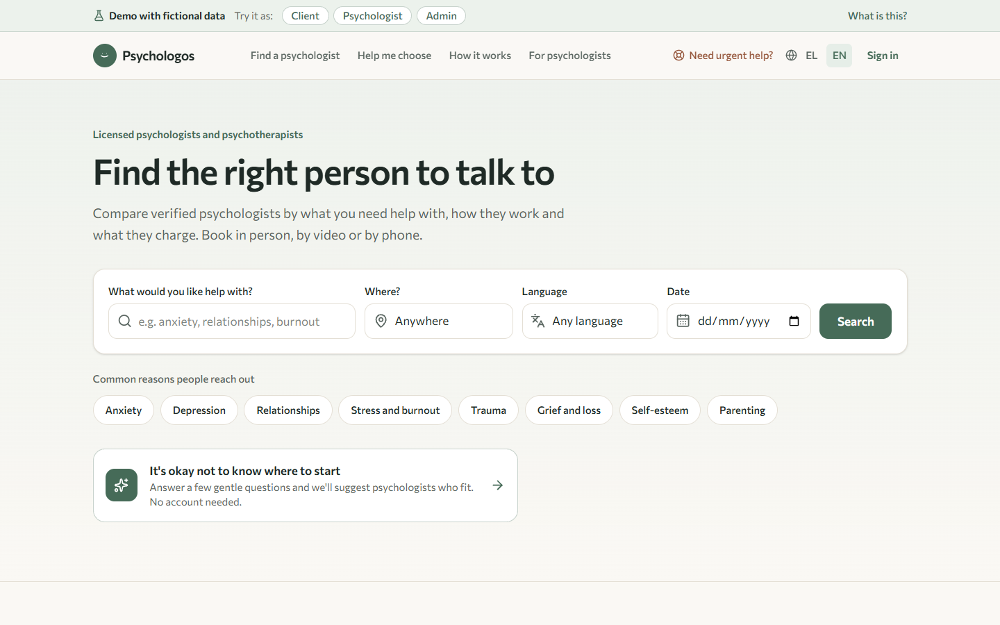
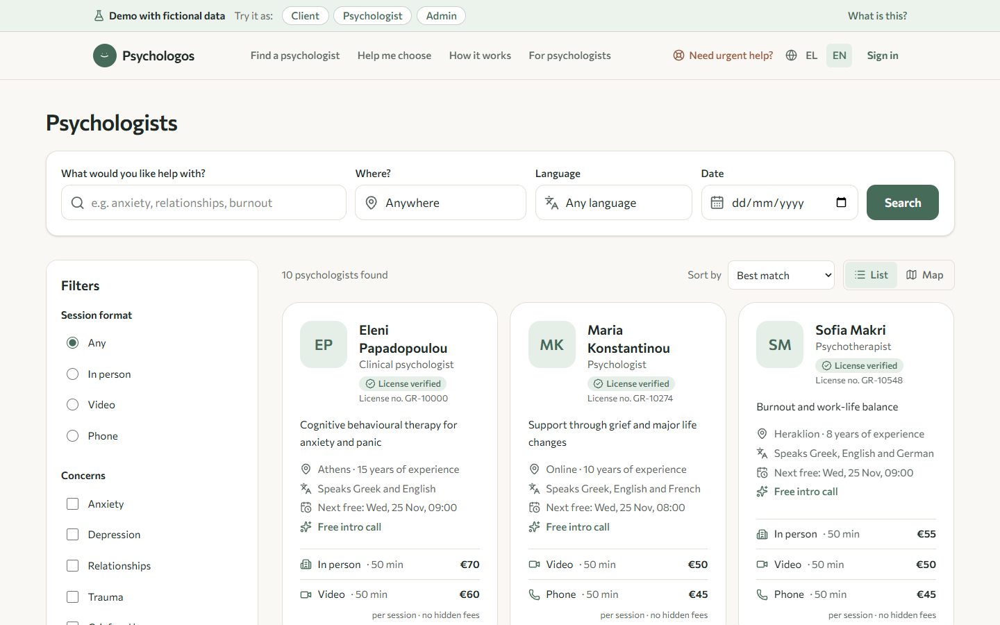
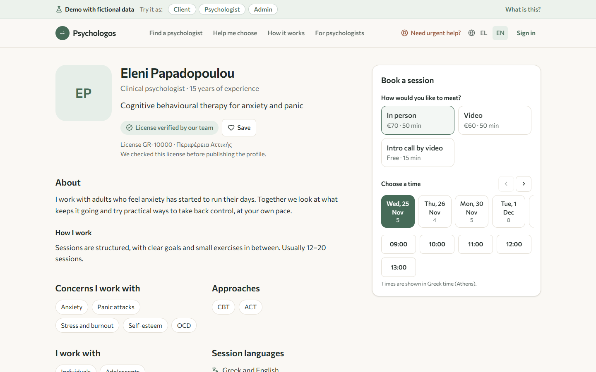
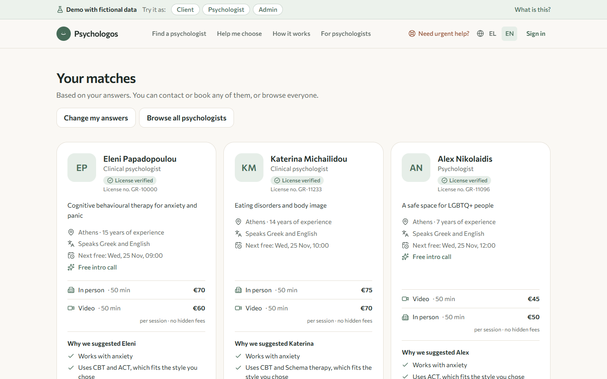
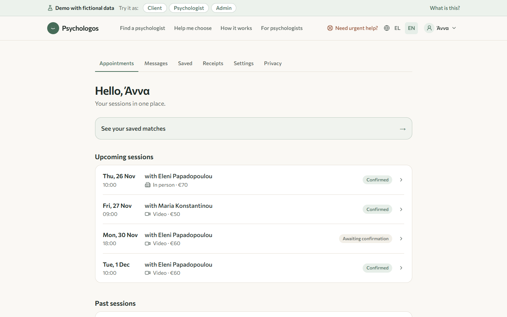
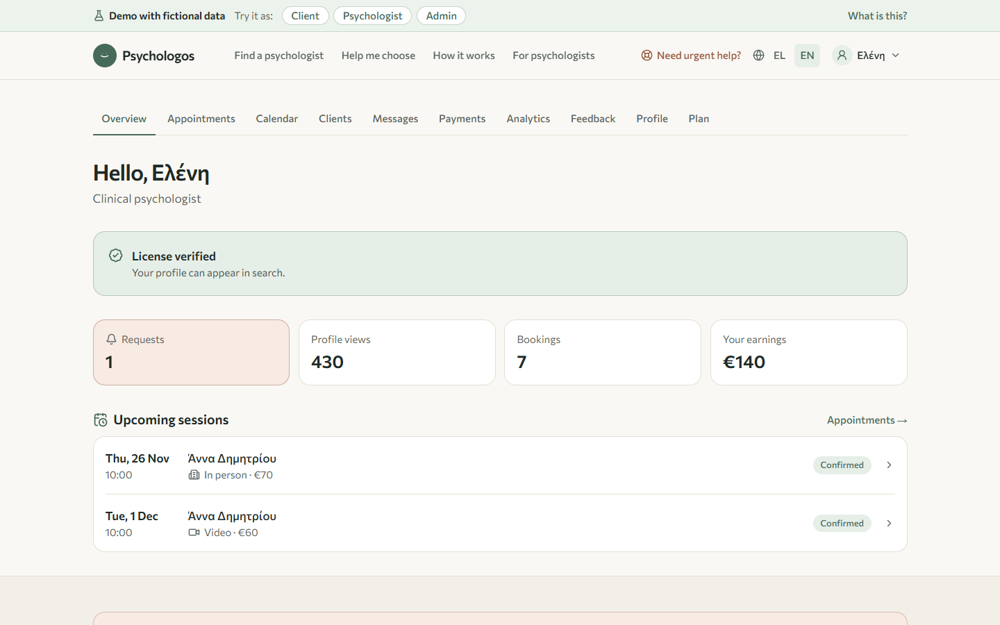
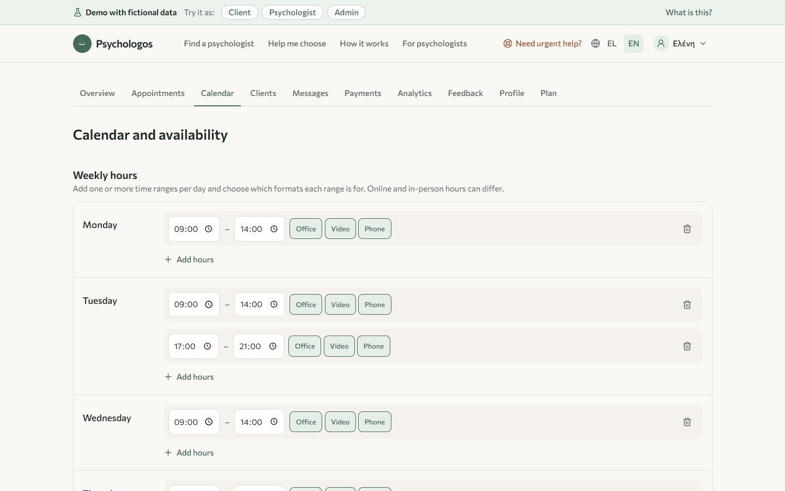
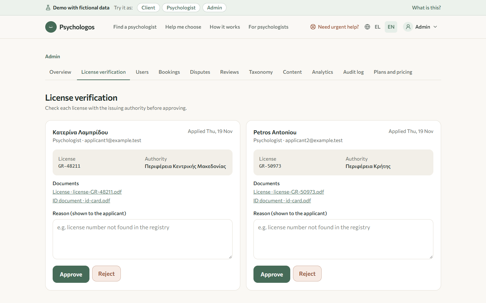
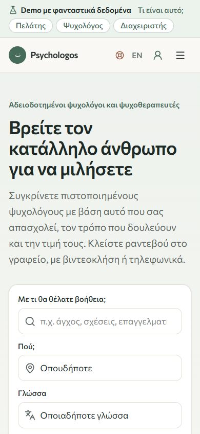
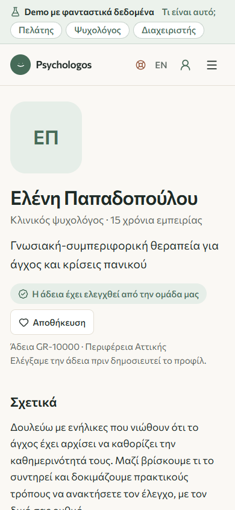

# Psychologos — find and book a licensed psychologist

[](https://github.com/40is40inos/psychologist-marketplace/actions/workflows/ci.yml)

A full-stack marketplace where people in Greece compare **licensed psychologists**,
see **real availability** and book **in-person, video or phone** sessions.
Psychologists run their practice from it (calendar, clients, encrypted notes,
payments, receipts), and an admin team verifies every license. Greek and
English throughout, prices in EUR, built to EU privacy standards for health data.

"Psychologos" is a working name; the brand is one setting (`NEXT_PUBLIC_BRAND_NAME`).

## Live demo

**[psychologist-marketplace-demo.onrender.com/en/demo](https://psychologist-marketplace-demo.onrender.com/en/demo)**
([Greek](https://psychologist-marketplace-demo.onrender.com/el/demo))

Sign in with **one click** as a client, a psychologist or an admin — no sign-up,
password or email. All data is fictional, and no emails, SMS or payments are
sent. The demo runs on a free plan, so it sleeps when idle: the first page can
take up to a minute to load.

## Screenshots

| | |
|---|---|
|  |  |
| **Home**: search by concern, place, language and date | **Search**: filters, sorting, list or map, next free slot |
|  |  |
| **Profile**: verified license, approach, prices, live calendar | **"Help me choose"**: questionnaire → 3–5 matches with plain reasons |
|  |  |
| **Client account**: upcoming and past sessions, requests | **Psychologist workspace**: requests, sessions, earnings |
|  |  |
| **Availability**: weekly hours per format, time off, sync | **Admin**: license verification, disputes, audit log |

<p>
  
  &nbsp;
  
</p>

Mobile-first and bilingual (Greek shown above). The demo guide is at
[`/en/demo`](docs/screenshots/demo-guide.png).

## Features

**Clients**
- Search by concern, approach, client type, city or online, language, gender, price and earliest availability; list or map view.
- "Help me choose": a short questionnaire suggests 3–5 psychologists and explains why.
- Book a real free slot, fill in an intake form, pay at the session or by card, add it to their calendar.
- Reschedule or cancel within each psychologist's policy, message the psychologist (encrypted), get reminders, download receipts.
- Privacy centre: consents, data export, account deletion.

**Psychologists**
- Onboarding wizard with license and ID upload, bilingual profile, prices per format, office with map.
- Weekly hours per format, buffers, notice, booking window, time off, extra hours, Google/Outlook calendar sync.
- Accept or decline requests, video sessions, client list with private encrypted notes.
- Payments (Stripe Connect payouts), Greek receipts ready for the tax authority's myDATA, analytics, feedback.

**Admins**
- License verification with document review and history, user management, bookings and refunds, payment disputes.
- Review moderation, editable taxonomy and languages, CMS for articles and legal pages, analytics.
- Append-only audit log of every view of sensitive records.

**Everyone**
- Email/password, magic links, Google sign-in, two-step sign-in (mandatory for psychologists and admins), password reset, email verification and change, sign out other devices.
- Crisis resources on every page ("Need urgent help?"), risk-signal detection in intake text, discreet emails and card statements.

## Tech stack

| Area | Technology |
|---|---|
| Framework | **Next.js 16** (App Router, Cache Components / partial prerendering, Server Actions), **React 19**, **TypeScript** |
| Styling | **Tailwind CSS 4** with design tokens (light and dark), own accessible UI primitives, lucide-react icons, Commissioner font (Latin + Greek) |
| Data | **PostgreSQL** with **Prisma 7** (`@prisma/adapter-pg`), hand-reviewed SQL migrations, Postgres full-text search |
| Validation | Zod 4 on every server action and route |
| Auth | Own implementation: scrypt passwords, hashed session and one-time tokens, TOTP 2FA (QR via `qrcode`), Google OIDC with PKCE verified by `jose` |
| Payments | **Stripe** Checkout (SCA) + Stripe Connect Express (destination charges, application fees, refunds) |
| Files | S3-compatible storage (Cloudflare R2 / AWS S3) via `aws4fetch`, signed direct uploads and downloads |
| Maps | Leaflet + react-leaflet (OpenStreetMap tiles, consent-gated) |
| Video, email, SMS | Daily.co or built-in WebRTC; Resend; Twilio (console fallbacks in development) |
| Testing and CI | **Vitest** (unit + database tests), **GitHub Actions** (migrations, schema drift check, lint, typecheck, tests, production build) |
| Hosting | Render + Neon (public demo), Vercel + Neon + R2 (free test site or production), all in Frankfurt (EU) |

## Engineering highlights

- **No double bookings.** Bookings for a psychologist are serialised with a transaction-scoped Postgres advisory lock, and the slot is re-checked inside the transaction (`src/lib/booking.ts`).
- **A pure, tested slot engine.** Weekly windows per format, buffers, notice, one-off extra hours and external busy times are combined in a database-free function that works in Athens local time and stays correct across daylight-saving changes. Because it touches no database, it's easy to test (`src/lib/availability.ts`, `tests/availability.test.ts`).
- **Health data encrypted at rest.** Messages, intake answers, session notes, tax IDs, IBANs and TOTP secrets use AES-256-GCM. Views of sensitive records are written to an append-only audit log.
- **Every sign-in method ends in one place.** Password, magic link and Google all finish in `completeSignIn`, so two-step sign-in can never be skipped. One-time links are stored only as hashes, are bound to a purpose (sign-in, reset, email change), work once, and confirm with a button so email scanners can't spend them.
- **Safe uploads on serverless hosts.** Browsers upload straight to the bucket with short-lived signed URLs. The server then checks the real file type from its first bytes and deletes anything invalid. Documents are served only after a permission check, through one-minute signed links.
- **Rate limiting shared by all instances.** One atomic `INSERT … ON CONFLICT` per check in Postgres, storing only a hash of the key (IP or email).
- **Search that understands Greek.** Postgres full-text search with a GIN expression index, accent folding and prefix matching, plus taxonomy matching across both languages (`src/lib/fts.ts`).
- **Caching with Cache Components.** Public data is cached with `"use cache"` and tags, and refreshed precisely with `updateTag` from server actions. Personal data streams in behind `Suspense`.
- **Type-checked translations.** The English dictionary defines the shape; the Greek one fails the type check if a key is missing.
- **Privacy and SEO built in.** GDPR consent records with versions, data export and deletion, essential-only cookies by default, a strict CSP and security headers, schema.org JSON-LD, sitemap and hreflang.
- **A safe public demo.** One-click demo accounts that visitors can't lock, bookings that stay current between deploys, and search engines kept out (`src/config/demo.ts`).

## Project structure

```
src/
  app/[lang]/        pages for /el and /en (account, dashboard, admin, booking, SEO pages)
  app/api/           route handlers (webhooks, cron jobs, files, calendar feeds, health)
  actions/           server actions (one file per area)
  lib/               domain logic: availability, booking, payments, search, crypto, auth
  domain/            shared constants and types (roles, taxonomy, session types)
  components/        UI, grouped by area, plus accessible primitives in components/ui
  i18n/              locale config and typed dictionaries
prisma/              schema, migrations, seed (demo data) and reference data
tests/               Vitest suites
docs/                data model, deployment guides, screenshots
```

## Getting started
```bash
cp .env.example .env      # set DATABASE_URL, DATA_ENCRYPTION_KEY, CRON_SECRET
npm install
npm run dev               # http://localhost:3000 -> redirects to /el or /en
```

### Database
No local Postgres? Prisma's built-in dev server works:
```bash
npx prisma dev --name psy --detach   # prints a postgres:// URL -> put it in DATABASE_URL
npx prisma migrate deploy            # apply migrations
npx prisma db seed                   # demo data + test accounts
```
With `prisma dev`, set `DATABASE_POOL_MAX=1` and `BUILD_CPUS=1` in `.env`: it
handles very few connections and can crash under a parallel build.

To create a new migration without a shadow database (needed with `prisma dev`):
```bash
git show HEAD:prisma/schema.prisma > /tmp/old.prisma
npx prisma migrate diff --from-schema /tmp/old.prisma --to-schema prisma/schema.prisma --script -o prisma/migrations/<timestamp>_<name>/migration.sql
npx prisma migrate deploy && npx prisma generate
```

Seed accounts all use `SEED_PASSWORD` from `.env`:
`admin@example.test` (admin), `client@example.test` (client),
`psychologist1@example.test` (verified psychologist),
`applicant1@example.test` (psychologist awaiting verification).
To try the one-click demo locally, start the dev server with `DEMO_MODE=true`.

### Checks
```bash
npm run lint
npm run typecheck   # generates Next.js route types first
npm test            # database tests run when DATABASE_URL is set
npm run build
```
CI runs all of these on every push and pull request, against a fresh Postgres.

## Deploy
- **Public demo** (fictional data, one-click demo accounts, free):
  Render + Neon. See [docs/deploy-render.md](docs/deploy-render.md).
- **Free test site** (Vercel Hobby + Neon + Cloudflare R2):
  [docs/deploy-free.md](docs/deploy-free.md).
- **Production** (paid plans, own domain, backups): [docs/deployment.md](docs/deployment.md).

---

# Implementation notes

The rest of this file maps each part of the original brief to where it lives
in the code.

## Market and basics
| Concern | Where |
|---|---|
| Brand name (env `NEXT_PUBLIC_BRAND_NAME`, "Psychologos" in the demo) and site address | `src/config/brand.ts` |
| Markets (GR now; add EU countries here), time zone, crisis lines | `src/config/market.ts` |
| Locales, Intl tags, default locale | `src/i18n/config.ts` |
| Dictionaries (`en.ts` defines the shape; `el.ts` must match or the type check fails) | `src/i18n/dictionaries/` |
| Locale routing: `/el/...`, `/en/...`; cookie → Accept-Language → Greek | `src/proxy.ts` |
| EUR formatting from integer cents, dates/times in Europe/Athens | `src/lib/format.ts`, `src/lib/time.ts` |
| Session types: `in_person`, `video`, `phone` | `src/domain/session-types.ts` |

## User roles
| Role | Area | Can do |
|---|---|---|
| Client | `/[lang]/account` | Appointments, messages, saved, receipts, reminder settings |
| Psychologist | `/[lang]/dashboard` | Verification status, prices and intro-call toggle, bilingual profile, sessions, clients, messages |
| Admin | `/[lang]/admin` | Analytics, license verification, user suspension, disputes; all actions audited |

- Permissions: `src/domain/roles.ts` (`can(role, permission)`).
- Auth: scrypt hashes, hashed session tokens in `AuthSession`, httpOnly cookie.
  Sign-in, sign-up, magic links, password reset, contact form and uploads are
  rate-limited in Postgres (`src/lib/auth/rate-limit.ts`), shared by all server instances.
- Account security (`/[lang]/security`): change or set a password, change email
  (confirmed by a link to the new address), confirm email, see and sign out
  other devices. Every security change signs out other devices and sends a
  "was this you?" email (`src/actions/account-security.ts`, `src/lib/auth/tokens.ts`).
- Admins come from the seed (development) or `npm run db:create-admin` (production).
  Psychologists stay out of search until verified.

## Client features
| Feature | Where |
|---|---|
| Home search: concern, city or online, language, date | `src/components/search-form.tsx` |
| Results with filters (concerns, approach, client type, format, price, language, gender, earliest availability), sort, map view | `src/app/[lang]/psychologists/page.tsx`, `src/lib/search.ts` |
| Shared taxonomy (labels in dictionaries) | `src/domain/taxonomy.ts` |
| "Help me choose": 8 questions → 3–5 matches with reasons | `src/app/[lang]/match/`, `src/lib/matching.ts` |
| Profile: video (click-to-load), bio, education, license, approaches, prices, office map, cancellation policy, live calendar, FAQ | `src/app/[lang]/psychologists/[slug]/page.tsx` |
| Availability engine (weekly hours, time off, bookings, notice, buffer, DST-safe) | `src/lib/availability.ts` |
| Booking: format → slot → intake → reserve → confirmation; double-booking prevented with a per-psychologist advisory lock | `src/app/[lang]/psychologists/[slug]/book/`, `src/lib/booking.ts` |
| Free 15-minute intro call (psychologist toggle, one per client) | booking + dashboard prices form |
| Reschedule / cancel within the psychologist's policy (late cancellations flagged) | `src/app/[lang]/account/appointments/[id]/` |
| Receipts (printable), saved psychologists, reminder settings | `src/app/[lang]/account/*` |
| Messaging, AES-256-GCM encrypted at rest, only after a booking | `src/lib/messaging.ts`, `src/lib/crypto.ts` |
| Email + SMS: confirmation, 24h and 1h reminders, cancellations, `.ics` attached | `src/lib/notifications/`, `/api/cron/notifications` |
| Calendar download | `/api/appointments/[id]/ics` |
| Private post-session feedback (public only with explicit opt-in) | `Feedback` model, appointment page |

## Psychologist workspace (`/[lang]/dashboard`)
| Feature | Where |
|---|---|
| Onboarding wizard (personal, license + ID upload, education, specialties, photo/bio/video, prices, office, IBAN/ΑΦΜ, submit) | `dashboard/profile`, `src/actions/onboarding.ts` |
| Private file storage: S3-compatible bucket in production (direct browser uploads with signed URLs, real type checked from the first bytes), local disk in development; documents only for owner/admin via short-lived signed links | `src/lib/storage.ts`, `src/actions/uploads.ts`, `/api/documents/[id]`, `/api/photos/[id]` |
| Weekly hours per format, buffer, notice, booking window, time off, manual approval | `dashboard/calendar`, `src/lib/availability.ts` |
| Calendar sync: import busy times from Google/Outlook secret iCal links; export feed | `src/lib/calendar-sync.ts`, `/api/calendar/[token]`, `/api/cron/calendars` |
| Appointments: accept/decline, reschedule, cancel, no-show, completed, mark paid | `dashboard/appointments`, `src/lib/booking-psychologist.ts` |
| Video sessions: Daily.co when `DAILY_API_KEY` is set, otherwise built-in WebRTC (add TURN for production) | `/[lang]/session/[id]`, `src/lib/video.ts` |
| Client list and encrypted private notes (psychologist only) | `dashboard/clients` |
| Payments, receipts (Απόδειξη Παροχής Υπηρεσιών) and myDATA transmission with the psychologist's own credentials | `dashboard/payments`, `src/lib/invoicing.ts`, `src/lib/mydata.ts` |
| Profile analytics (views, search appearances, booking starts, bookings) | `dashboard/analytics`, `src/lib/analytics.ts` |
| Configurable plans (price, commission, features) | `dashboard/plan`, `/admin/plans`, `src/lib/plans.ts` |

myDATA: confirm the VAT exemption and income classification codes with an accountant
(`MYDATA_*` env vars); set `MYDATA_ENV=production` for the live endpoint.

## Admin panel (`/[lang]/admin`)
| Feature | Where |
|---|---|
| License verification with documents | `admin/verifications` |
| Users and psychologists, suspension | `admin/users` |
| Bookings and payments, refunds (audited), disputes | `admin/bookings`, `admin/disputes` |
| Review moderation (only consented + approved feedback is public, anonymous) | `admin/reviews` |
| Editable taxonomy and session languages (database-driven, cached) | `admin/taxonomy`, `src/lib/taxonomy-data.ts` |
| CMS for blog articles and static pages (safe Markdown) | `admin/content`, `/[lang]/blog`, `/[lang]/p/[slug]` |
| Analytics: signups, bookings, revenue, refunds, top searches, no-result searches | `admin/analytics`, `SearchLog` |

The seeded privacy/terms/cookies pages are templates and must be reviewed by legal counsel.

## Mental-health safeguards
| Requirement | How |
|---|---|
| Crisis safety | "Need urgent help?" link in the header of every page → `/[lang]/urgent-help` (static, tap-to-call 112 / 1018 / 10306); crisis notice in the footer and the booking flow; "not an emergency service" stated everywhere |
| Risk signals | `src/lib/risk.ts` (Greek + English, accent-insensitive) flags intake text live and on save; optional safety question in "Help me choose" (answer never stored). Crisis resources appear immediately; psychologists see a risk note on the booking |
| Reviews policy | Feedback is private by default (`src/config/policy.ts`, `PUBLIC_TESTIMONIALS=false`). Psychologists see it without client names; profiles show only aggregated indicators (reply time, % held as scheduled) above minimum sample sizes |
| Discretion | Neutral email subjects and bodies (no names, therapy words or session types), neutral calendar titles, optional "no platform name" in SMS, neutral card-statement descriptor (`PAYMENT_STATEMENT_DESCRIPTOR`) |
| Accessibility | WCAG 2.1 AA: AA contrast on all colour tokens (light + dark), labelled controls, skip link, `lang` per page and per text block, logical headings, 320px reflow, reduced-motion support |

Pick a brand name and card-statement descriptor that don't reveal the service ("psych", "therapy").

### Scheduled jobs
| Job | Every | Purpose |
|---|---|---|
| `/api/cron/notifications` | 5 minutes | reminders and queued emails/SMS |
| `/api/cron/calendars` | 15 minutes | external calendar sync |
| `/api/cron/retention` | daily (hourly on paid plans) | data minimisation, expired holds and rate limits |

Each call needs `Authorization: Bearer $CRON_SECRET`. On Vercel's free plan
only the daily job can live in `vercel.json`; the others run from an external
scheduler such as cron-job.org (see [docs/deployment.md](docs/deployment.md)).
```bash
curl -X POST -H "Authorization: Bearer $CRON_SECRET" https://your-domain/api/cron/notifications
```
Without `RESEND_API_KEY` / `TWILIO_*` the messages are written to the server log.

### Not yet
- Recurring weekly sessions and session packages.
- Billing psychologists for paid plans (plan prices are stored but not charged),
  and platform commission invoices.
- Error tracking and monitoring (e.g. Sentry with EU data residency).
- Map tiles use OpenStreetMap's public server; set `NEXT_PUBLIC_MAP_TILE_URL`
  to a commercial (EU-hosted) tile provider before launch.

## Compliance and security
| Requirement | How |
|---|---|
| GDPR consent | Separate, explicit Art. 9 health-data consent at client sign-up; every consent stored as a versioned `ConsentRecord` (`LEGAL_VERSION` in `src/config/legal.ts`). Withdrawing it blocks booking and messaging. Manage in *Account → Privacy* (psychologists/admins: *Security*) |
| Minimisation | `/api/cron/retention` (daily, or hourly on paid plans) deletes expired sessions and rate-limit counters, video signalling (1 day), search logs (13 months), notification logs (12 months) and releases unpaid card holds |
| Export / deletion | `/api/account/export` (JSON, decrypted); self-service deletion anonymises the account and deletes messages, intake answers, feedback text and saved items; receipts kept without the name, as tax law requires |
| Cookie banner | Essential cookies only by default; maps/videos load only after "Allow" (equal-weight buttons, changeable later). Third-party map tiles are click-to-load without consent |
| Privacy policy | DPA-ready template (`prisma/seed-legal.ts`): controller vs processor roles, Art. 6/9 legal bases, EU processors table, transfers, retention table, rights, HDPA complaint route |
| EU data residency | Deploy app, database and file storage in an EU region (e.g. Frankfurt); Stripe Payments Europe (Ireland); choose EU regions for email/SMS/video. Fill in the processors table in the privacy policy |
| Encryption | AES-256-GCM at rest for session notes, intake answers, messages, tax IDs, IBANs, myDATA credentials and TOTP secrets (`DATA_ENCRYPTION_KEY`); HSTS + TLS everywhere; strict security headers and CSP (`next.config.ts`) |
| Access control | Role permissions in `src/domain/roles.ts`; append-only audit log of views of client records, intake answers, documents, exports, deletions and 2FA changes (`/[lang]/admin/audit`) |
| 2FA | TOTP (RFC 6238) with QR setup and 10 one-time recovery codes; **mandatory** for psychologists and admins (`TWO_FACTOR_ENFORCE`), optional for clients |
| Payments | Stripe Checkout (hosted page, PCI SAQ A, SCA/3-D Secure): card data never touches our servers. Slot held 30 min while paying; approval-required bookings authorise and capture on accept, release on decline; refunds (client cancellation minus late fee, psychologist cancellation, admin) go back to the card. Webhook `/api/webhooks/stripe` verifies signatures and is idempotent |
| Terms | Client terms, psychologist terms with an Art. 28 data-processing agreement, cancellation/refund policy, cookie policy, linked at sign-up and in the footer |

All legal pages are **templates for legal review**. The seed refreshes a legal
page only while it still begins with the template note, so CMS edits survive.

### Enabling card payments
1. Set `STRIPE_SECRET_KEY` (test key first) and `PAYMENT_STATEMENT_DESCRIPTOR`.
2. Add a webhook endpoint for `https://your-domain/api/webhooks/stripe` with
   `checkout.session.completed`, `checkout.session.expired`,
   `checkout.session.async_payment_succeeded` and `checkout.session.async_payment_failed`;
   put its signing secret in `STRIPE_WEBHOOK_SECRET`.
3. Locally: `stripe listen --forward-to localhost:3000/api/webhooks/stripe`.

Without a key, clients pay at the session and the card option is hidden.

### Running retention
```bash
curl -X POST -H "Authorization: Bearer $CRON_SECRET" https://your-domain/api/cron/retention
```

## Design direction
| Brief | How |
|---|---|
| Calm, warm, human | Soft warm neutrals (`--bg #faf8f4`), generous spacing, rounded-3xl cards with soft shadows; no clinical blues or hard edges |
| One gentle accent | Sage `--primary #466b58` (6:1 with white, 5:1+ on every background). The muted clay `--accent` is only for attention states (warnings, late cancellation, destructive actions). Tokens in `src/app/globals.css`, mirrored for dark mode |
| Friendly sans, large text | Commissioner (Latin + Greek) for body and headings; root size 106.25% (17px by default, still follows browser settings), line-height 1.6 |
| Real photography | Larger, softly rounded portrait slots (`src/components/avatar.tsx`); photo guidance in the psychologist profile editor. Psychologists upload their own photos. The demo seed uses initials, so no stock photos of people pretend to be therapists |
| Soft illustrations | Token-coloured line illustrations for empty states (`src/components/ui/illustrations.tsx`), wired into the shared `EmptyState` |
| Reassuring microcopy | e.g. "It's okay not to know where to start" on the home page, gentle empty-state and no-results copy, in Greek and English |
| Trust signals | Verified badge plus license number on every card and profile, "We checked this license" note, "No booking fees or hidden costs" on cards, profiles and the booking summary |

## Pages
Every route is under `/el/…` and `/en/…`.

| Page | Route |
|---|---|
| Home | `/` |
| Search results (filters, list/map) | `/psychologists` |
| Psychologist profile | `/psychologists/[slug]` |
| Matching questionnaire | `/match`, `/match/results` |
| Booking flow | `/psychologists/[slug]/book` → `/account/appointments/[id]` |
| Client dashboard | `/account` (appointments, messages, saved, receipts, settings, privacy) |
| Psychologist dashboard | `/dashboard` (calendar, appointments, clients, payments, profile, analytics, plan, feedback, messages) |
| Video session room | `/session/[id]` |
| Admin panel | `/admin` |
| For psychologists (benefits, plans from the database, sign-up) | `/for-psychologists` |
| Blog / articles | `/blog`, `/blog/[slug]` |
| Concern pages (SEO) | `/anxiety`, `/depression`, … (every active concern with at least one public profile) |
| City pages (SEO) | `/psychologists-athens`, `/psychologists-thessaloniki`, … |
| About, Privacy, Terms, Cookies, Cancellation, Terms for psychologists | `/p/[slug]` (CMS) |
| FAQ | `/faq` |
| Contact (rate-limited form, emailed to support, nothing stored) | `/contact` |
| Crisis resources | `/urgent-help` |

Concern and city pages show live listings, price and online stats, internal
links and an FAQ with `FAQPage` + `BreadcrumbList` structured data. Optional
editorial copy comes from CMS pages named `concern-<slug>` / `city-<slug>`
(see the seeded `concern-anxiety`). `/sitemap.xml` lists all public pages with
hreflang alternates; `/robots.txt` keeps private areas out of search.

## Tech stack choices
| Area | Brief | Built with |
|---|---|---|
| Frontend | Next.js App Router + TS + Tailwind + shadcn/ui | Next.js 16 (App Router, Cache Components, server actions), React 19, TypeScript, Tailwind 4. **Not shadcn/ui:** the UI uses a small set of our own accessible primitives (`src/components/ui`) on the same design tokens, the same copy-in approach shadcn uses, without Radix. Add shadcn for complex widgets (combobox, dialog) when needed; it reads the same CSS variables |
| Backend | API routes / Node; Postgres + Prisma | Next.js route handlers and server actions; PostgreSQL with Prisma 7 (`@prisma/adapter-pg`) |
| Auth | Email/password, Google, magic links, 2FA | scrypt passwords; **Sign in with Google** (OIDC + PKCE, ID token verified with Google's JWKS via `jose`, verified emails only, new accounts only after explicit consent; linking to an unverified account drops its password to prevent takeover); **magic links**, password reset and email confirmation (hashed, purpose-bound one-time tokens with a confirm button so email scanners can't spend them); TOTP 2FA. Every method ends in `completeSignIn`, so 2FA always applies |
| Payments | Stripe Connect / Viva Wallet | **Stripe Connect Express**: psychologists onboard from *Workspace → Payments*; card bookings are destination charges with the plan commission as application fee; refunds reverse the transfer and fee; the platform stays merchant of record (neutral statement name). Card payment is offered only once a psychologist's account is ready |
| Video | Daily.co / Twilio / Whereby | Daily.co (`DAILY_API_KEY`), with built-in peer-to-peer WebRTC as fallback |
| Email / SMS | Resend/Postmark + Twilio/Infobip | Resend + Twilio, console fallback in development |
| Search | Postgres FTS, or Meilisearch/Algolia | **Postgres full-text search** on profile text (GIN index, `simple` config, Greek accent folding, prefix matching) in `src/lib/fts.ts`, plus taxonomy matching across languages. Swappable behind `searchProfileText` |
| Hosting | EU region | Everything in Frankfurt. **Public demo:** Render web service (`render.yaml`) + Neon Postgres. **Production / test site:** Vercel (`vercel.json` pins `fra1` and runs migrations on deploy) + Neon + Cloudflare R2 with EU jurisdiction. `/api/health` and `/api/ping` for uptime checks |
| SEO | SSR, schema.org, sitemap, hreflang | Server rendering with partial prerendering; JSON-LD `Person` + `MedicalBusiness` (license as credential, address, prices) on profiles, `WebSite` + `SearchAction` and `Organization` on home, `FAQPage` / `BreadcrumbList` on content pages; `/sitemap.xml` and `alternates.languages` hreflang on every public page |
| Quality | — | Vitest unit and database tests (`tests/`); GitHub Actions CI on every push and pull request: migrations on a fresh Postgres, schema drift check, lint, typecheck, tests, production build |

### Enabling Google sign-in and payouts
- Google: set `GOOGLE_CLIENT_ID` / `GOOGLE_CLIENT_SECRET` (redirect URI `/api/auth/google/callback`). The buttons appear automatically.
- Stripe Connect: enable Connect (Express) in the Stripe dashboard, add a Connect webhook for `account.updated` to `/api/webhooks/stripe` and set `STRIPE_CONNECT_WEBHOOK_SECRET`.

## Data model
Every entity in the brief has a model; see **[docs/data-model.md](docs/data-model.md)**
for the entity-to-model table, an ER diagram and where sensitive data is
encrypted. Notable models: `ClientProfile` (preferences, encrypted saved
matches), `IntakeForm` (intake answers moved out of `Appointment`),
`AvailabilityException` (was `TimeOff`; now also extra hours) and
`LicenseVerification` (history of license checks). The migration renames and
copies existing rows, so no data is lost.

## Conventions
- Money is integer cents + currency; timestamps are UTC; display uses Europe/Athens.
- Greek names are transliterated (ELOT 743) on non-Greek pages: `src/lib/slug.ts`.

### Adding a language
1. Add the code to `locales` in `src/i18n/config.ts`.
2. Add `src/i18n/dictionaries/<code>.ts` typed as `Dictionary`.
3. Add the value to the `Locale` enum in `prisma/schema.prisma`.

### Adding a country
Add an entry to `markets` in `src/config/market.ts` with **verified** crisis
line numbers, and a `Country` row in the database.
