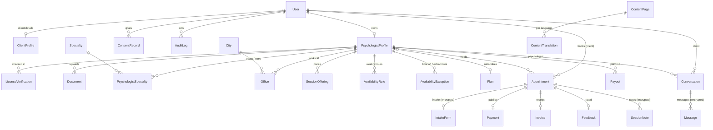

# Data model

The schema lives in [`prisma/schema.prisma`](../prisma/schema.prisma) (PostgreSQL, Prisma 7).
Conventions: money in integer cents with a currency, timestamps in UTC,
translatable text in `*Translation` tables keyed by locale, health data
encrypted at rest with AES-256-GCM (`src/lib/crypto.ts`).

## Required entities → models

| Entity (brief) | Model(s) | Notes |
|---|---|---|
| User | `User`, `AuthSession`, `LoginToken` | Login identity only: email, password hash (scrypt) or Google id, role, status, 2FA. `LoginToken` holds hashed magic-link tokens |
| ClientProfile | `ClientProfile` | 1:1 with a client `User`: preferred language and format, saved matching answers (**encrypted**). Optional by design |
| PsychologistProfile | `PsychologistProfile`, `PsychologistProfileTranslation`, `PsychologistEducation`, `PsychologistFaq`, `SessionOffering` | Public profile, per-language text, prices per format, policies, Stripe Connect account |
| License / Verification | `PsychologistProfile` (current licence and status), `LicenseVerification` (history), `Document` (uploaded licence and ID) | Every admin decision is stored with the licence as it was checked |
| Specialty | `Specialty` (`kind = concern`) and `PsychologistSpecialty` | Admin-editable labels per language |
| Approach | `Specialty` (`kind = approach`) | Same table as concerns and client types: one taxonomy, one editor |
| Language | `Language` | Session languages (codes), admin-editable |
| Location / Office | `Country`, `City`, `CityTranslation`, `Office` | Offices have coordinates for the map and accessibility info |
| AvailabilityRule | `AvailabilityRule` | Weekly windows, optionally limited to formats |
| AvailabilityException | `AvailabilityException` | Time off (`unavailable`) or extra hours (`available`) for a date range |
| Appointment | `Appointment` | Status machine incl. `awaiting_payment`; reschedules link old → new |
| Payment | `Payment` | Pay at session or card (Stripe / Stripe Connect), holds, refunds, commission |
| Payout | `Payout` (+ Stripe Connect transfers) | Period summaries; card money is paid out by Stripe Connect |
| Invoice | `Invoice` | Numbered receipts per psychologist, myDATA status and MARK |
| IntakeForm | `IntakeForm` | 1:1 with an appointment, answers **encrypted**, risk flag, question-set version |
| SessionNote (encrypted) | `SessionNote` | **Encrypted**, visible only to the author |
| Message (encrypted) | `Conversation`, `Message` | **Encrypted** bodies; a conversation opens after a booking |
| Feedback | `Feedback` | Private by default; public only with consent and moderation |
| SubscriptionPlan | `Plan` | Monthly price, commission (basis points), feature flags, default plan |
| BlogPost | `ContentPage` (`kind = article`) + `ContentTranslation` | Also static and legal pages (`kind = page`) |
| AuditLog | `AuditLog` | Append-only: admin actions and every view of sensitive records |

Supporting models: `ConsentRecord` (GDPR proof of consent), `Notification`,
`Dispute`, `SavedPsychologist`, `ExternalCalendar` / `ExternalBusy`
(calendar sync), `VideoRoom` / `VideoSignal`, `ProfileStat` (analytics),
`SearchLog` (searches with no results, anonymous).

## Core relationships

## Sensitive data

| Data | Where | Protection |
|---|---|---|
| Intake answers | `IntakeForm.answersEncrypted` | AES-256-GCM; views audited; deleted with the account |
| Session notes | `SessionNote` | AES-256-GCM; author only |
| Messages | `Message.bodyEncrypted` | AES-256-GCM; deleted with the account |
| Saved matching answers | `ClientProfile.matchAnswersEncrypted` | AES-256-GCM; never put in URLs |
| Tax ID, IBAN, myDATA keys, TOTP secrets | `PsychologistProfile`, `User` | AES-256-GCM |
| Passwords, magic-link tokens, recovery codes | `User`, `LoginToken` | Hashes only (scrypt, SHA-256) |
